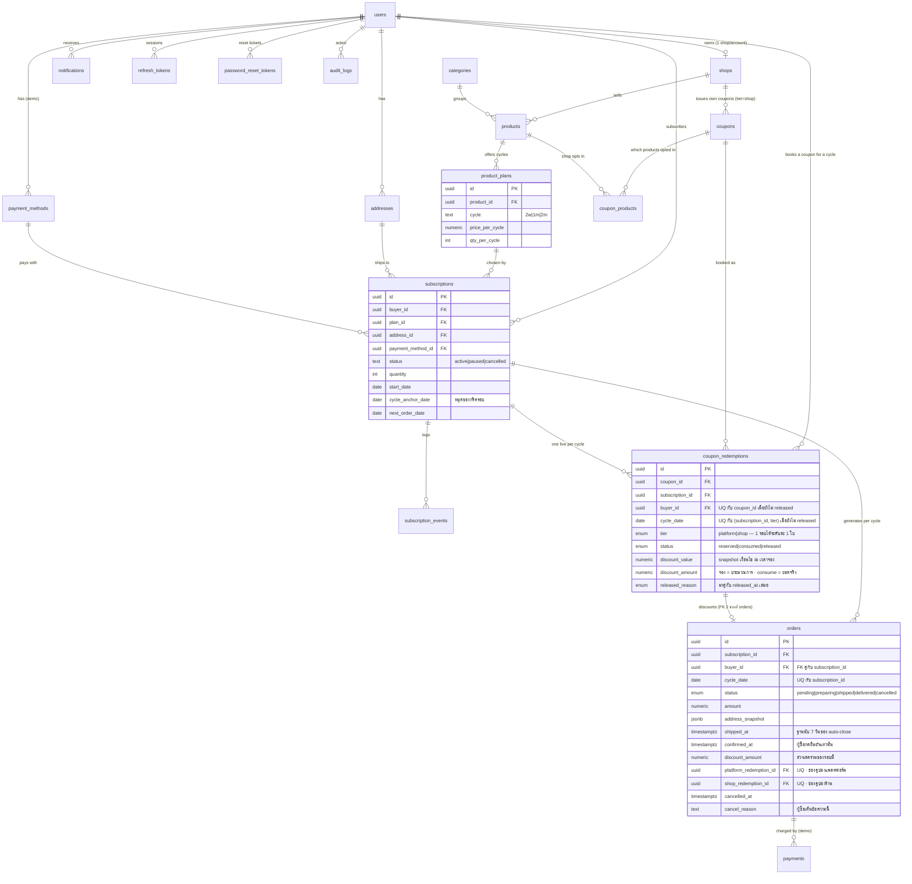

# ANAN — Database Schema Design

> อัปเดต: 2026-08-16 · ย้ายมาสถาปัตยกรรม NestJS + Prisma
> **Source of truth: [`anan-api/prisma/schema.prisma`](../anan-api/prisma/schema.prisma)** — แก้ที่ไฟล์นั้นแล้ว `npx prisma migrate dev` (กฎข้อ 4 ใน CLAUDE.md) จากนั้นอัปเดตเอกสารนี้ให้ตรง
> CHECK constraint และ partial index ที่ Prisma เขียนเองไม่ได้ อยู่ใน migration `..._check_constraints` ที่เขียนมือ — **ห้ามลบ**
> **เรื่องสิทธิ์/ความปลอดภัย ยึด [security-design.md](security-design.md) เป็นหลัก** — ตอนนี้การอนุญาตอยู่ที่ guard + service ของ API ไม่ใช่ RLS แล้ว

## ER Diagram

(`engine_runs` เป็นตาราง log แยกเดี่ยว ไม่มี FK — เขียนโดย `EngineService` เท่านั้น)

## ตารางทั้งหมด (23 ตาราง)

| ตาราง | หน้าที่ | Feature spec |
|---|---|---|
| `users` | ผู้ใช้ + credential (รวม `auth.users` กับ `profiles` เดิมเข้าด้วยกัน) — `password_hash` มี CHECK ว่าต้องเป็น bcrypt | [01](../context/planing/01-auth.md) |
| `refresh_tokens` | session ที่เพิกถอนได้ — เก็บ **sha256 ของ token** ไม่เก็บตัว token | [01](../context/planing/01-auth.md) |
| `password_reset_tokens` | ตั๋วรีเซ็ตรหัสผ่านที่ส่งไปทางอีเมล — เก็บ **sha256** เช่นกัน · อายุ 30 นาที · `used_at` ปิดใบทั้งตอนใช้จริงและตอนถูกแทนที่ (เพิ่ม 2026-08-22) | [01](../context/planing/01-auth.md) |
| `addresses` | ที่อยู่จัดส่ง (หลายที่อยู่/คน) | [01](../context/planing/01-auth.md) |
| `payment_methods` | บัตรที่ผูกไว้ — เก็บ `brand` + `last4` + `exp_month`/`exp_year` + ชื่อบนบัตร, `kind` ล็อกไว้ที่ `card` | [09](../context/planing/09-payment-demo.md) |
| `shops` | ร้านค้า (1 ร้าน/บัญชี — `owner_id` unique) | [10](../context/planing/10-seller-shop.md) |
| `categories` | หมวดสินค้า (seed ล่วงหน้า client แก้ไม่ได้) | [02](../context/planing/02-catalog.md) |
| `products` | สินค้า + `net_amount`/`unit` ไว้คำนวณราคาต่อหน่วยตอนเปรียบเทียบ | [02](../context/planing/02-catalog.md), [04](../context/planing/04-compare.md) |
| `product_plans` | แผนรอบส่งต่อสินค้า (2w/1m/2m) — unique ต่อ (product, cycle) | [03](../context/planing/03-product-detail.md), [11](../context/planing/11-seller-products.md) |
| `subscriptions` | หัวใจของระบบ — สถานะ + `next_order_date` ที่ engine ใช้ | [05](../context/planing/05-subscribe-checkout.md), [06](../context/planing/06-my-subscriptions.md) |
| `subscription_events` | log ทุก action (pause/skip/cancel/…) — แหล่งข้อมูลวิเคราะห์ churn ในเล่ม | [06](../context/planing/06-my-subscriptions.md) |
| `orders` | ออเดอร์ราย cycle — **UQ (subscription_id, cycle_date) = idempotency** | [07](../context/planing/07-orders-history.md), [12](../context/planing/12-seller-orders.md) |
| `payments` | การตัดเงินจำลอง (paid/failed) ผูกกับ order | [09](../context/planing/09-payment-demo.md) |
| `notifications` | แจ้งเตือน in-app | [08](../context/planing/08-notifications.md) |
| `engine_runs` | log การรัน recurring engine แต่ละครั้ง | [13](../context/planing/13-recurring-engine.md) |
| `order_issues` | เคสปัญหาที่ผู้ซื้อแจ้ง (1 เคส/ออเดอร์) — สัญญาณคุณภาพร้านสำหรับ admin | [16](../context/planing/16-delivery-confirmation.md) |
| `reviews` | รีวิว 1 ต่อ subscription + `cycles_received` ที่ snapshot ไว้ตอนรีวิว | [17](../context/planing/17-reviews.md) |
| `mail_settings` | ตั้งค่าเมลที่ผู้ดูแลแก้จากหน้าจอได้ — **แถวเดียวเสมอ** (CHECK `id = 1`) · ไม่มี credential ของ SMTP อยู่ในนี้ (เพิ่ม 2026-08-22) | [14](../context/planing/14-admin.md) |
| `audit_logs` | ร่องรอยการกระทำที่มีสิทธิ์สูง — **เขียนอย่างเดียว** ไม่มี endpoint แก้/ลบ (เพิ่ม 2026-08-22 · ปิด A-3) | [14](../context/planing/14-admin.md) |
| `email_logs` | อีเมลขาออกทุกฉบับ — ผู้รับตัวจริง vs ปลายทางที่ส่งไป + ผลลัพธ์ · **ไม่เก็บเนื้อเมล** (เพิ่ม 2026-08-22) | [14](../context/planing/14-admin.md) |

### คูปองรายรอบ 2 ระดับ — Phase 8 (migration `20260824093000_coupons` + `20260824140000_shop_coupons`)

| ตาราง | หน้าที่ | Feature spec |
|---|---|---|
| `coupons` | แคมเปญคูปอง **2 ระดับ** (`tier` = platform/shop · `shop_id` มีเมื่อเป็นของร้าน) — `in_use_count` เป็นตัวเดียวที่คุมโควตา (จองอยู่ + ใช้แล้ว) | [18](../context/planing/18-coupons.md) |
| `coupon_products` | **ร้าน** ติ๊กว่าสินค้าไหนของตัวเองเข้าร่วมคูปองใบไหน (ใช้ทั้งสองระดับ) — การเข้าร่วมคือความสมัครใจ = ร้านรับภาระส่วนลดเอง · คูปองร้านที่ตั้ง `applies_to_all_products` ไม่ต้องมีแถวที่นี่ | [18](../context/planing/18-coupons.md) |
| `coupon_redemptions` | **ผู้ซื้อ** จองคูปองกับ *รอบ* หนึ่ง (`reserved` → `consumed` / `released`) + snapshot เงื่อนไขและ `tier` ณ เวลาจอง | [18](../context/planing/18-coupons.md) |

คอลัมน์ที่เพิ่มใน `orders`: `discount_amount` + **`platform_redemption_id` / `shop_redemption_id`** (FK แบบ `RESTRICT` ทั้งคู่) — **`amount` คงความหมายเดิมคือยอดที่ตัดจริง** เพื่อไม่ให้ retry payment / คืนเงิน / ใบเสร็จ ต้องแก้แม้แต่บรรทัดเดียว
คอลัมน์ที่เพิ่มใน `products`: **`coupon_policy`** — ร้านตั้งเองว่าสินค้าชิ้นนั้นรับคูปองระดับไหนบ้าง

## การตัดสินใจออกแบบ (ใส่ในเล่มได้)

1. **Idempotency ด้วย unique constraint** — `orders UNIQUE (subscription_id, cycle_date)` ทำให้ recurring engine รันซ้ำกี่ครั้งก็ไม่สร้างออเดอร์ซ้ำ ป้องกันที่ระดับ DB ไม่ใช่แค่ระดับโค้ด
2. **`address_snapshot` เป็น jsonb ในออเดอร์** — ก็อปที่อยู่ ณ ตอนสร้างออเดอร์ ผู้ใช้แก้ที่อยู่ทีหลังแล้วประวัติออเดอร์เก่าไม่เพี้ยน
3. **สถานะทุกตัวเป็น Postgres enum** — ได้ทั้ง type safety ใน TypeScript (Prisma generate ให้เป็น union type) และการบังคับที่ DB พร้อมกัน ชื่อ enum member = ค่าใน DB = ค่าที่ส่งออก API จึงไม่มีชั้นแปลงให้พลาด · **ยกเว้น `cycle`** ที่ยังเป็น text + CHECK เพราะค่า `'2w'` ขึ้นต้นด้วยตัวเลข ซึ่งเป็นชื่อ identifier ของ Prisma enum ไม่ได้ และการเปลี่ยนค่าจะทำให้ spec 17 ไฟล์กับโค้ดฝั่งแอปไม่ตรงกัน
4. **ไม่ cascade delete จาก `product_plans` → `subscriptions`** — FK แบบ restrict ทำให้ลบสินค้า/แผนที่มีคน subscribe อยู่ไม่ได้ ต้องใช้ `is_active = false` แทน (ปิดรับคนใหม่ subscriber เดิมอยู่ต่อ)
5. **บัตรเก็บเท่าที่ผู้ให้บริการจริงเก็บหลัง tokenization** — `brand` · `last4` · `exp_month`/`exp_year` · ชื่อบนบัตร · ไม่มีเลขบัตรเต็มและไม่มี CVV แม้เป็นเลขปลอม
   · `kind` ล็อกไว้ที่ `card` (enum ค่าเดียว) กันเผลอเพิ่มชนิดใหม่โดยไม่ผ่านการตัดสินใจ
   · UNIQUE `(user_id, last4, exp_month, exp_year)` แทน fingerprint ของเลขบัตรที่ระบบจริงใช้กันบัตรซ้ำ — เราไม่มีเลขเต็มให้ hash จึงกันด้วยชุดที่เก็บไว้จริง
6. **แยก `one_time_price` (อ้างอิง) กับ `price_per_cycle`** — ใช้โชว์ "ถูกกว่าซื้อครั้งเดียว X%" ซึ่งเป็นจุดขายหลัก
7. **แยก `is_active` (เจ้าของปิดเอง) ออกจาก `suspended_at` (แอดมินระงับ)** — คอลัมน์เดียวทำสองหน้าที่ทำให้ร้านที่ถูกระงับ `update is_active = true` ปลดแบนตัวเองได้ ตอนนี้ `suspended_at` ไม่มี grant ให้ client เลย
8. **ไม่มี client ตัวไหนพูดกับ DB ได้เลย** — ทุกการเขียนผ่าน service ของ API ที่ห่อด้วย `prisma.$transaction` ได้ 2 อย่างพร้อมกัน: กันการปลอมข้อมูล (เช่น insert `payments` status `paid` เอง) และได้ atomicity (update + insert event ในทรานแซกชันเดียว แทน 2 request ที่อาจสำเร็จครึ่งเดียว)
9. **state machine อยู่ในฐานข้อมูล** — CHECK `subs_state_consistent` ทำให้ "cancelled ถาวร" เป็นข้อเท็จจริงของ DB ไม่ใช่กติกาใน UI ต่อให้ service เขียนพลาด DB ก็ยังปฏิเสธ
10. **แยก `orders.status = 'delivered'` (ร้านกด) ออกจาก `orders.confirmed_at` (ผู้ซื้อกด)** — ฝ่ายที่ได้ประโยชน์จากการบอกว่า "ส่งแล้ว" ไม่ควรเป็นฝ่ายเดียวที่ยืนยันได้ `confirmedAt` ไม่อยู่ใน DTO ของฝั่งร้านเลย และ CHECK `orders_confirm_after_ship` กันไม่ให้ยืนยันออเดอร์ที่ยังไม่ออกจากร้าน
11. **รีวิวผูกกับ `subscription_id` ไม่ใช่ `product_id`** — unique ต่อ subscription ทำให้รีวิว 1 ใบ = ประสบการณ์ 1 สาย และเก็บ `cycles_received` snapshot ได้ว่า "รีวิวหลังใช้มาแล้วกี่รอบ" ซึ่งเป็นข้อมูลที่ e-commerce แบบซื้อครั้งเดียวไม่มีทางมี
12. **`paused` มี 2 ความหมาย จึงต้องมี `paused_reason`** — "ผู้ซื้อกดหยุดเอง" กับ "ระบบแช่แข็งเพราะแอดมินระงับร้าน" ใช้สถานะเดียวกันไม่ได้ เพราะอย่างหลังผู้ซื้อต้อง resume เองไม่ได้ · CHECK `subs_paused_reason_only_when_paused` กันไม่ให้ค่านี้ค้างหลัง resume
13. **นิยามของคำว่า "ถึงรอบ" ต้องมีที่เดียว** — เดิมเงื่อนไขกระจายอยู่ใน WHERE ของ engine ทำให้ลืมเช็คว่าร้านถูกระงับหรือยัง ผลคือแพลตฟอร์มเรียกเก็บเงินให้ร้านที่ตัวเองสั่งระงับ · ตอนนี้อยู่ที่ `EngineService.dueSubscriptions()` เมธอดเดียว ห้ามมีใครเขียน where เองซ้ำ
14. **`users` รวม credential กับ profile ไว้ตารางเดียว** — เดิมต้องแยกเพราะ Supabase เป็นเจ้าของสคีมา `auth` ตอนนี้เราเป็นเจ้าของ auth เอง การแยกสองตารางที่มี id เดียวกัน 1:1 จึงเหลือแต่ความซับซ้อน · `password_hash` มี CHECK ว่าต้อง match `^\$2[aby]\$` → เผลอเขียน plaintext ลง DB ไม่ได้เลย
15. **`orders.buyer_id` เป็น denormalization ที่ DB บังคับความถูกต้องเอง** — มีไว้ให้ ownership check เขียนเป็น `where: { id, buyerId }` ได้ในเงื่อนไขเดียว (แทน join 3 ชั้นทุกครั้ง) แต่ข้อมูลซ้ำที่ไม่มีอะไรบังคับคือหนี้ในอนาคต จึงประกาศ `UNIQUE(id, buyer_id)` บน `subscriptions` แล้วให้ `orders` อ้าง FK **คู่** `(subscription_id, buyer_id)` → เป็นไปไม่ได้ทางกายภาพที่ค่าจะเพี้ยนไปจากเจ้าของจริง
16. **`refresh_tokens` เก็บ hash ไม่เก็บ token** — DB หลุดแล้วผู้ได้ไปยังสวมสิทธิ์ไม่ได้ · CHECK บังคับว่าต้องเป็น sha256 hex 64 ตัว → เผลอเก็บตัว token จริงจะถูกปฏิเสธทันที
17. **`subscriptions.cycle_anchor_date` — วันตัดรอบทุกวันคือ "หมุด + k×cycle"** _(เพิ่ม Phase 3)_
    ถ้าคำนวณรอบถัดไปด้วยการบวกทบจาก `next_order_date` เดิม วันตัดเงินจะยุบถาวรหลังผ่านเดือนสั้นครั้งเดียว: สมัคร 31 ม.ค. รายเดือน → 28 ก.พ. → 28 มี.ค. → 28 เม.ย. ทั้งที่ผู้ใช้คาดหวัง 31 มี.ค./30 เม.ย. · เก็บหมุดไว้เป็นคอลัมน์แล้วให้ทุกฝ่าย (engine + action ของ W05) คิดจากหมุดเดียวกัน ทำให้ "รอบถัดไป" มีนิยามเดียวคือ `nextCycleAfter(anchor, cycle, หลังวันไหน)` ใน `src/common/date.ts`
    **หมุดขยับเฉพาะ action ที่นิยามรอบใหม่จริง ๆ**: เลื่อนวันส่ง · กลับมาใช้งาน (หลังหยุดนาน) · เปลี่ยนรอบส่ง — ส่วน **ข้ามรอบไม่ขยับหมุด** เพราะมันคือการเลื่อนไป 1 ช่องบนกริดเดิม ไม่ใช่การเปลี่ยนตารางส่ง
18. **`refresh_tokens.revoked_reason` — "ถูกเพิกถอนแล้ว" ไม่เท่ากับ "รั่ว"** _(เพิ่ม Phase 3 · แก้ A-8)_
    เดิม token ที่ถูกเพิกถอนแล้วถูกใช้ซ้ำจะถูกตีความว่ารั่วทุกกรณี แล้วระบบตัดทุก session ของบัญชีนั้น → ใครก็ตามที่เคยเห็น token ที่ logout ไปแล้วเตะเจ้าของออกจากทุกเครื่องได้ตลอดเวลา · ตอนนี้มีเฉพาะใบที่ถูก **หมุน** (`rotated`) เท่านั้นที่ทำให้ revoke ทั้งบัญชี ส่วน `logout` ตอบ 401 เฉย ๆ · CHECK `refresh_tokens_revoke_consistent` บังคับว่าเวลาเพิกถอนกับเหตุผลต้องมาคู่กันเสมอ (เหตุผลหาย = กลับไปเป็นบั๊กเดิมเงียบ ๆ)

19. **`orders.shipped_at` — นับ 7 วันจาก "วันที่ของออกจากร้าน" ไม่ใช่ "วันตัดรอบ"** _(เพิ่ม Phase 4.5)_
    engine ปิดออเดอร์ที่ส่งแล้วเกิน 7 วันให้อัตโนมัติ (ไม่งั้นออเดอร์ที่ผู้ซื้อไม่กลับมากดจะค้าง `shipped` ตลอดกาล) · ถ้านับจาก `cycle_date` ร้านที่ส่งช้า 5 วันจะทำให้ระบบปิดออเดอร์ให้ทั้งที่ของเพิ่งออกจากร้าน 2 วัน — คนละความหมายกันคนละเรื่อง · การปิดอัตโนมัติ **ไม่แตะ `confirmed_at`** สถิติ "ผู้ซื้อยืนยันเอง" จึงยังเชื่อถือได้
20. **`payments_lifecycle` — CHECK เดียวที่ครอบทุกสถานะของเงิน** _(เพิ่ม Phase 4.5)_
    เดิมมี CHECK ว่า `paid` ต้องมี `paid_at` แยกกับกฎอื่น ผลคือ **คืนเงินไม่ได้เลย**: แถวที่ refund แล้วยังมี `paid_at` ค้างอยู่ (ซึ่งถูกต้อง — มันเคยจ่ายจริง) แต่สถานะไม่ใช่ `paid` แล้ว · รวมเป็นกฎเดียวที่บอกว่าแต่ละสถานะต้องมี/ห้ามมีเวลาไหนบ้าง ทำให้ flow ยกเลิก+คืนเงินของ [feature 15](../context/planing/15-order-exceptions.md) เป็นไปได้โดยไม่ต้องผ่อนกฎ
22. **`mail_settings` — ตารางแถวเดียวที่บังคับด้วย CHECK ไม่ใช่ด้วยมารยาท** _(เพิ่ม 2026-08-22)_
    `CHECK (id = 1)` ทำให้ "มีสองแถวแล้วไม่รู้ว่าอันไหนคือค่าที่ใช้อยู่" เป็นไปไม่ได้ · และ `CHECK (redirect_enabled = false OR redirect_to IS NOT NULL)` ทำให้ **"เปิดโหมดเปลี่ยนเส้นทางแต่ไม่มีปลายทาง" เป็นไปไม่ได้** — สภาพนั้นแปลว่าอีเมลทุกฉบับของระบบหายเงียบ ๆ โดยไม่มี error ที่ไหนเลย
    **ค่าที่เว้นว่าง = "ใช้ของ `.env`"** ไม่ใช่ "ไม่มีค่า" — ผู้ดูแลจึงเปลี่ยนแค่ host ไปชี้ Mailtrap ตอนซ้อมได้โดยไม่ต้องกรอกทั้งชุด · `SMTP_USER`/`SMTP_PASS` **ไม่มีคอลัมน์ในตารางนี้** เพราะเป็น credential จริง (กฎข้อ 7)
23. **`email_logs.redirected` — ธงที่โกหกไม่ได้** _(เพิ่ม 2026-08-22)_
    `CHECK (redirected OR to_actual = to_intended)` — ถ้าแถวบอกว่า "ไม่ได้เปลี่ยนเส้นทาง" ปลายทางต้องตรงกับผู้รับจริงเสมอ · ถ้าไม่มีกฎนี้ หน้า log อาจแสดงว่า "ส่งถึงเจ้าตัวแล้ว" ทั้งที่เมลไปเข้ากล่องอื่น ซึ่งเป็นการโกหกที่อันตรายกว่าไม่มี log เลย
    `CHECK ((status = 'failed') = (error IS NOT NULL))` ใช้รูปแบบเดียวกับ `refresh_tokens_revoke_consistent` — เหตุผลต้องมาคู่กับความล้มเหลวเสมอทั้งสองทาง
24. **`audit_logs` เขียนอย่างเดียว และ `actor_id` เป็น `SET NULL` ไม่ใช่ `CASCADE`** _(เพิ่ม 2026-08-22 · ปิดความเสี่ยง A-3)_
    ถ้าเป็น cascade การลบบัญชีจะลบประวัติการกระทำของบัญชีนั้นไปด้วย ซึ่งเท่ากับ "ลบตัวเองแล้วร่องรอยหายหมด" · `SET NULL` ทำให้แถวยังอยู่และ `summary` ยังอ่านออก
    **`summary` ถูกสรุปเป็นข้อความไทยตั้งแต่ตอนเขียน ไม่ใช่ตอนอ่าน** — ของที่ถูกอ้างถึง (ร้าน/หมวด/สินค้า) อาจถูกลบไปแล้วตอนผู้ดูแลเปิดหน้า log · ถ้าไปประกอบข้อความตอนอ่าน แถวเก่าจะกลายเป็น "ลบหมวด (ไม่พบชื่อ)" ทั้งกระดาน
21. **`password_reset_tokens` — ตั๋วกู้บัญชีถูกออกแบบตามแบบเดียวกับ `refresh_tokens`** _(เพิ่ม 2026-08-22)_
    ตารางนี้เก็บ **กุญแจสำรองของทุกบัญชีในระบบ** ใครอ่านคอลัมน์เดียวได้ก็ยึดบัญชีไหนก็ได้ — จึงใช้แบบเดียวกับ refresh token ทุกข้อ: เก็บ sha256 ไม่เก็บ token, CHECK `password_reset_tokens_hash_fmt` บังคับ hex 64 ตัว (token จริงเป็น base64url 43 ตัว เขียนลงไปไม่ผ่าน), CHECK `..._lifetime` กันตั๋วที่หมดอายุตั้งแต่วินาทีที่เกิด
    **`used_at` ตัวเดียวครอบสองความหมาย** ("ใช้ตั้งรหัสไปแล้ว" กับ "ถูกแทนที่เพราะขอใบใหม่") ต่างจาก `refresh_tokens` ที่ต้องแยก `revoked_reason` เพราะที่นั่นมีเหตุผลหนึ่งที่แปลว่า token รั่ว (A-8) แต่ที่นี่ไม่มี — ตั๋วรีเซ็ตที่ถูกใช้ซ้ำแปลว่าผู้ใช้กดลิงก์เก่า ไม่ใช่สัญญาณของการโจมตี
    **ตั้งรหัสใหม่สำเร็จ = เพิกถอน refresh token ทุกใบ** ด้วย `revoked_reason = 'password_reset'` (ค่าใหม่ใน enum เดิม) — ถ้าไม่ทำ คนที่แอบเข้าบัญชีอยู่ยังอยู่ต่อได้อีก 7 วันเต็มทั้งที่เจ้าของเพิ่งเปลี่ยนรหัส ซึ่งทำให้การรีเซ็ตไม่มีความหมายเลย

25. **คูปองใน subscription เป็นของที่ "จองไว้กับรอบ" ไม่ใช่ของที่ "ใช้แล้วจบ"** _(เพิ่ม 2026-08-24 · Phase 8)_
    ใน e-commerce คูปองถูกใช้ตอน checkout ที่ผู้ซื้อยืนอยู่ตรงนั้น แต่ที่นี่รอบที่ 2 เป็นต้นไป **engine เป็นคนสร้างออเดอร์ตอนตี 1 โดยผู้ซื้อไม่อยู่** คูปองจึงต้องถูก "จอง" ไว้ล่วงหน้าแล้วรอ — ระหว่างนั้นเกิดอะไรได้เยอะ (skip · pause · ยกเลิก · ร้านถูกระงับ) จึงต้องมีสถานะของตัวเอง `reserved → consumed | released`
    **`in_use_count` นับทั้งที่จองอยู่และที่ใช้แล้ว** เพราะโควตาต้องถูกกินตั้งแต่ตอนจอง ไม่งั้นวันตัดเงินจริงจะมีคนถือสิทธิ์เกินโควตา · ตัดสินโควตาด้วย `UPDATE … WHERE in_use_count < max_redemptions` ไม่ใช่ SELECT-แล้ว-INSERT (แพตเทิร์นเดียวกับ `refresh_tokens` และ notification unique index)
    **partial unique 2 ตัวคือหัวใจ**: `(subscription_id, cycle_date) WHERE status <> 'released'` = 1 รอบ 1 ใบ (แต่คืนแล้วจองใหม่ได้) · `(coupon_id, buyer_id) WHERE status <> 'released'` = **ยกเลิก subscription แล้วสมัครใหม่ก็ใช้คูปองซ้ำไม่ได้** ซึ่งเป็นกฎที่เช็คในโค้ดแล้วเอาไม่อยู่
    **idempotency ไม่ต้องเขียนเพิ่มเลย** — การ consume อยู่ใน tx เดียวกับการสร้างออเดอร์ engine รันซ้ำวันเดิมชน `orders UNIQUE (subscription_id, cycle_date)` แล้ว rollback ทั้งก้อน คูปองจึงถูกใช้ได้ครั้งเดียวโดยอัตโนมัติ

26. **คูปอง 2 ระดับ — เพดาน "ซ้อนได้ไม่เกิน 2 ใบ" มาจากโครงสร้าง ไม่ใช่จากโค้ด** _(เพิ่ม 2026-08-24 · Phase 8 รอบ 2)_
    partial unique `coupon_one_per_cycle_tier` บน `(subscription_id, cycle_date, tier)` ทำให้ "1 รอบ ได้ระดับละ 1 ใบ" เป็นข้อเท็จจริงของ DB · จำนวนระดับสูงสุดที่ซ้อนได้จึงเท่ากับจำนวนค่าใน enum `coupon_tier` เอง และฝั่ง `orders` มี **2 ช่องตายตัว** (`platform_redemption_id` / `shop_redemption_id`) ซึ่งเป็นการบังคับเพดานเดียวกันซ้ำอีกชั้น — ต่างจากการย้าย FK ไปฝั่ง `coupon_redemptions.order_id` ที่จะรับกี่ใบก็ได้
    **`tier` เป็นคอลัมน์จริง ไม่ derive จาก `shop_id IS NULL`** เพราะ partial index ต้องเกาะคอลัมน์ และใบจองต้อง snapshot ระดับไว้ (ร้านอาจถูกลบสิทธิ์ทีหลัง แต่รอบที่จองไว้ต้องยังรู้ว่าอยู่ช่องไหน) · CHECK `coupons_tier_shop_consistent` บังคับว่าระดับกับเจ้าของร้านต้องตรงกันทั้งสองทาง — สภาพ "คูปองร้านที่ไม่มีร้าน" คือสภาพที่ตอบไม่ได้ว่าใครรับภาระส่วนลด
    **ด่านสุดท้ายอยู่ฝั่งสินค้า ไม่ใช่ฝั่งคูปอง** — `products.coupon_policy` ให้ร้านปิดระดับรายชิ้นได้โดยไม่ต้องถอนออกจากแคมเปญทั้งใบ
27. **`orders.quantity` — จำนวนชิ้นเป็นข้อเท็จจริงของรอบ ไม่ใช่ค่าที่อ่านสดจาก subscription** (Phase 8.3 · 2026-11-21)
    พอผู้ซื้อแก้จำนวนต่อรอบได้ (`POST /subscriptions/:id/quantity`) การให้ร้านอ่าน `subscriptions.quantity` สด ๆ ทำให้จ่าย 1 ชิ้นแล้วแก้เป็น 10 ก่อนร้านแพ็คของได้ · ออเดอร์จึงเก็บจำนวนของตัวเอง (NOT NULL · CHECK 1-10) และ trigger `guard_order_update` ห้ามแก้เหมือนยอดเงิน · migration backfill แถวเก่าจาก subscription ซึ่งถูกต้องเพราะก่อนหน้านี้จำนวนแก้ไม่ได้
28. **`subscriptions.cancel_reason` (enum) + `cancel_note` + `resume_on`** (Phase 8.3) — เหตุผลเป็น enum เพื่อนับรวมได้ (ข้อมูลดิบของ "ทำไม churn") · CHECK: เหตุผลมีได้เฉพาะ cancelled · note ต้องมีเหตุผล · `resume_on` มีได้เฉพาะ `paused/user` (การแช่แข็งของแอดมินต้องไม่มีวันหมดอายุเอง) · ไม่บังคับ NOT NULL ตอน cancelled เพราะแถวที่ยกเลิกก่อนมีฟีเจอร์ไม่มีเหตุผล — ด่านของรายการใหม่อยู่ที่ DTO

## สิทธิ์การเข้าถึง (บังคับที่ API ไม่ใช่ที่ DB แล้ว)

**สิ่งที่เปลี่ยนไปจากสถาปัตยกรรมเดิม:** ก่อนหน้านี้ client คุยกับ Postgres ตรงผ่าน PostgREST ฐานข้อมูลจึงต้องป้องกันตัวเองด้วย RLS + GRANT รายคอลัมน์ ตอนนี้ **ไม่มี client ตัวไหนต่อ DB ได้เลย** — มีแค่ API ที่ถือ credential ของ role `anan_app` ชั้นการอนุญาตจึงย้ายไปอยู่ที่ guard + `where` clause ใน service

> นี่คือ **แลก** ไม่ใช่ได้ฟรี: RLS บังคับให้ทุก query ปลอดภัยโดยอัตโนมัติแม้คนเขียนจะลืม ส่วนวิธีใหม่ต้องอาศัยวินัย จึงต้องมี [security-rules.md](security-rules.md) §B และ e2e เคส "คนอื่นเรียก → 404" ทุก endpoint มาชดเชย

| ตาราง | Buyer | Seller | Admin | Engine |
|---|---|---|---|---|
| `users` | อ่าน/แก้ของตัวเอง — `isAdmin`/`isSeller` ไม่อยู่ใน DTO ใดเลย | เหมือน buyer | อ่านทุกคน (aggregate) | — |
| `refresh_tokens` | ระบบจัดการให้ ไม่มี endpoint ให้อ่าน | — | — | — |
| `addresses` / `payment_methods` | ของตัวเองเท่านั้น (บัตร: เพิ่ม/ลบ ไม่มีแก้) | — | — | — |
| `shops` | อ่าน (active และไม่ถูกระงับ) | เปิดร้าน + แก้ร้านตัวเอง — `suspendedAt` ไม่อยู่ใน DTO ของร้าน | ระงับ/คืน | — |
| `products` / `product_plans` | อ่าน (ต้องผ่านทั้งสินค้าและร้าน) | เขียนของร้านตัวเอง — `shopId`/`productId`/`cycle`/`suspendedAt` ตรึง | อ่านทั้งหมด + ระงับ | — |
| `categories` | อ่าน | อ่าน | CRUD (`@Roles('admin')`) | — |
| `subscriptions` | อ่าน/สั่งการของตัวเอง ผ่าน 7 action ของ W05 | ❌ ไม่เห็นแถว (เห็นเป็น forecast รวม) | อ่านทั้งหมด | อ่าน + เลื่อน `nextOrderDate` |
| `subscription_events` | อ่านของตัวเอง (เขียนไม่ได้ — audit trail) | — | อ่านทั้งหมด | เขียน |
| `orders` | อ่านของตัวเอง + ยืนยันรับของ + แจ้งปัญหา | อ่านของร้านตัวเอง + เปลี่ยน `status`/`trackingNote` ทีละขั้น | อ่านทั้งหมด | สร้างรอบถัดไป |
| `payments` | อ่านของตัวเอง · เขียนได้ทางเดียวคือ `POST /orders/:id/retry-payment` ของออเดอร์ตัวเอง (ยอดมาจาก DB) | ❌ เห็นแค่ว่าออเดอร์จ่ายแล้วหรือยัง (ออเดอร์ที่ยังไม่จ่ายถูกซ่อนทั้งใบ) | อ่านทั้งหมด | สร้างตอนถึงรอบ · คืนเงินจำลองตอนร้านยกเลิก |
| `notifications` | อ่านของตัวเอง + ทำเครื่องหมายอ่านแล้ว | เหมือน buyer | — | สร้าง |
| `engine_runs` | ❌ | ❌ | อ่าน | เขียน/อ่าน |
| `order_issues` | แจ้งเคสของตัวเอง + อ่าน | อ่าน/ปิดเคสของร้านตัวเอง | อ่านทั้งหมด | — |
| `reviews` | เขียนได้เมื่อรับของแล้วอย่างน้อย 1 รอบ | อ่านผ่าน endpoint สาธารณะ (ชื่อผู้รีวิวถูก mask) | อ่านทั้งหมด | — |
| Cloudinary | อ่าน | อัปโหลดผ่าน signed upload ของ API เท่านั้น (≤2 MB, jpeg/png/webp) | — | — |

**Engine** ไม่ใช่ "role พิเศษที่ bypass อะไร" อีกต่อไป — มันคือ service ในโปรเซสเดียวกับ API ที่ไม่ได้ผูกกับ request ของผู้ใช้คนไหน สิ่งที่กันไม่ให้ client สร้างออเดอร์/ตัดเงินเองคือ **ไม่มี endpoint ให้ทำ** ไม่ใช่ policy

**Admin** (`users.is_admin` — ตั้งผ่าน seed เท่านั้น ไม่มี endpoint ไหนยกระดับสิทธิ์ได้): ตรวจด้วย `RolesGuard` จาก claim ใน JWT ที่ verify แล้ว การระงับร้าน/สินค้าเขียนที่ `suspendedAt` ซึ่งไม่ปรากฏใน DTO ของฝั่งร้านเลย ([feature 14](../context/planing/14-admin.md))

## Migrations

| โฟลเดอร์ | สถานะ | ของข้างใน |
|---|---|---|
| `20260816083501_init` | ✅ | Prisma generate — 16 ตาราง, 9 enum, FK, unique, index (รวม FK คู่ `orders(subscription_id, buyer_id)`) |
| `20260816083600_check_constraints` | ✅ | **เขียนมือ ห้ามลบ** — 52 CHECK (ความยาว/รูปแบบ/ช่วงตัวเลข/state machine/bcrypt/sha256/link ในแอป) + partial index `idx_subs_due`, `idx_orders_awaiting_confirm` |
| `20260822092210_password_reset` | ✅ | ตาราง `password_reset_tokens` + ค่า `password_reset` ใน enum `refresh_token_revoked_reason` · **ท้ายไฟล์เขียนมือ ห้ามลบ** — CHECK `..._hash_fmt` / `..._lifetime` / `..._used_order` |
| `20260822115200_admin_settings_and_logs` | ✅ | ตาราง `mail_settings` (+ แถวตั้งต้น id=1) · `audit_logs` · `email_logs` + enum `audit_action`/`email_log_status` · **ท้ายไฟล์เขียนมือ ห้ามลบ** — CHECK singleton, `redirect_needs_target`, รูปแบบอีเมล/โฮสต์/พอร์ต, `email_logs_redirect_consistent`, `email_logs_error_consistent` |

**ทำไมต้องแยกเป็น 2 ไฟล์:** Prisma schema language เขียน CHECK constraint และ partial index ไม่ได้ แต่กฎข้อ 4 ของโปรเจกต์บอกว่าความถูกต้องของข้อมูลต้องอยู่ใน DB · โชคดีที่ Prisma **มองไม่เห็น** CHECK constraint จึงไม่พยายามลบทิ้งตอน `migrate dev` ครั้งถัดไป (ต่างจาก index/unique ที่ต้องประกาศใน `schema.prisma` เท่านั้น ไม่งั้นโดนลบ)

> migration ชุด Supabase เดิม 6 ไฟล์ย้ายไปเก็บที่ [`docs/archive/supabase-sql/`](archive/supabase-sql/) แล้ว (ลบออกจากโปรเจกต์ 2026-08-19) — เก็บไว้เทียบสองสถาปัตยกรรมในเล่ม ไม่ได้ใช้รันแล้ว
